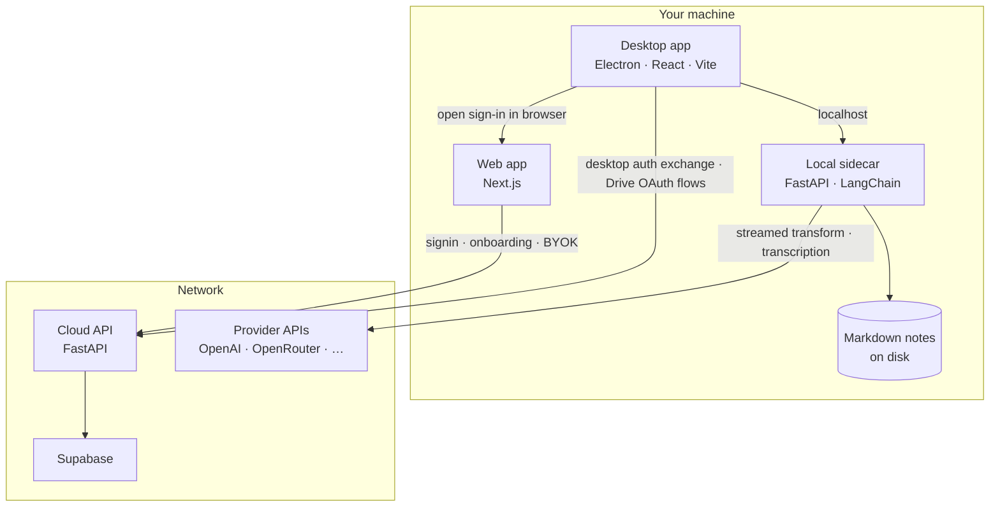

# Notebook AI

Desktop-first AI note taker with a local-first Electron UX, a Next.js web app, and FastAPI/LangChain backends.

Licensed under the [MIT License](./LICENSE). Third-party programs are listed in [NOTICE](./NOTICE).

You can open the desktop app and keep notes on this machine without an account. Sign in only when you want Google Drive mirror or the web account vault.

## Architecture

Notebook AI is a monorepo:
- `apps/desktop`: Electron + React + Vite desktop recorder/editor
- `apps/web`: Next.js landing, signup/signin, onboarding, and web settings
- `services/local-sidecar`: local FastAPI note/transcript API
- `services/cloud-api`: hosted FastAPI auth/provider/settings API
- `packages/contracts`: shared TypeScript API contracts
- `packages/theme`: shared design tokens (light/dark)
- `packages/ui`: shared React primitives

## Why a local sidecar?

A **sidecar** here is a small **local HTTP service** you run next to the desktop app (not a second cloud). It exists so normal work stays **local-first and low-latency**:

- **Notes:** Create, list, and save markdown through the sidecar so content stays on your filesystem and the UI does not depend on a remote service for every edit.
- **AI and transcription:** Streaming transforms and audio round-trips go to the sidecar on `localhost`, which talks to provider APIs using keys from the sidecar `.env` or keys saved locally by the desktop app on that device.

The **cloud API** is a separate companion: Supabase auth validation, session refresh/logout, web/mobile provider vault storage, storage preferences, desktop auth handoff, and Drive integration metadata. It does **not** store your note markdown or sit in the path for debounced note persistence. Desktop notes, local provider keys, transcription, and AI work without signing in. Google Drive mirror and the web vault require an account.

Credential scope is intentionally split:
- Desktop BYOK is stored locally on the device through `services/local-sidecar` and is not synced to the account vault.
- Web and future mobile clients store BYOK only in the cloud API's encrypted account vault.
- Hosted AI routes can use vault credentials server-side, but raw provider secrets do not go back to browser or mobile clients.

## UX Highlights

- Fast local-first note editing with debounced persistence
- Streaming AI action panel (`summarize`, `rewrite`, `extract_action_items`)
- Unified web + desktop visual system with shared tokens/components
- Dark and light themes with persisted preference

## Get started

Follow [Getting started](./docs/getting-started.md) to install dependencies, run the desktop app without an account, and optionally start the cloud API.

The public Mac download will live on the domain you attach. Set `NEXT_PUBLIC_DESKTOP_DOWNLOAD_URL` to that URL when the domain is ready. Until then, **Download for Mac** opens the GitHub latest release.

## Setup Guides

- [Getting started](./docs/getting-started.md)
- [Supabase, Google Sign-In, and Google Drive Setup](./docs/supabase-google-setup.md)
- [macOS desktop release](./docs/desktop-release-macos.md)

## Environment

Copy the placeholder file and leave secrets empty:

- [`services/local-sidecar/.env.example`](services/local-sidecar/.env.example)
- [`services/cloud-api/.env.example`](services/cloud-api/.env.example)
- [`apps/desktop/.env.example`](apps/desktop/.env.example)
- [`apps/web/.env.example`](apps/web/.env.example)

Do not commit `.env` files. Audio transcoding uses `ffmpeg` on your `PATH` when it is installed. Releases do not bundle ffmpeg.

## Versioning And Releases

- `VERSION` is the repo-wide source of truth.
- Run `npm run version:sync` after bumping `VERSION`.
- Generate release notes with `npm run release:notes -- --version <x.y.z>`.
- Build the macOS sidecar package with `npm run release:sidecar:mac`.
- Build the macOS desktop DMG with `npm run release:desktop:mac`.
- See [docs/releases/PROCESS.md](./docs/releases/PROCESS.md) for branch naming and release cadence.

## API Surface

- Local sidecar:
  - `POST /notes`
  - `GET /notes`
  - `PUT /notes/{id}`
  - `PATCH /notes/{id}/move`
  - `DELETE /notes/{id}`
  - `GET /folders`
  - `POST /folders`
  - `PATCH /folders/{id}`
  - `DELETE /folders/{id}`
  - `GET /storage/local-root`
  - `PUT /storage/local-root`
  - `GET /storage/preference`
  - `PUT /storage/preference`
  - `GET /sync/status`
  - `POST /sync/run`
  - `POST /ai/transform/stream` (SSE)
  - `GET /providers/status`
  - `POST /providers/byok`
  - `GET /providers/models`
  - `DELETE /providers/{provider}`
- Cloud API:
  - `POST /auth/session/refresh`
  - `POST /auth/logout`
  - `GET /settings/storage`
  - `PUT /settings/storage`
  - `POST /providers/openai/oauth/start`
  - `GET /providers/openai/oauth/callback`
  - `POST /integrations/google-drive/oauth/start`
  - `GET /integrations/google-drive/oauth/callback`
  - `GET /integrations/google-drive/status`
  - `POST /integrations/google-drive/access-token`
  - `POST /providers/byok` (web/mobile encrypted account vault)
  - `GET /providers/status`
  - `GET /providers/credential` (server-side use only)
  - `DELETE /providers/{provider}`
