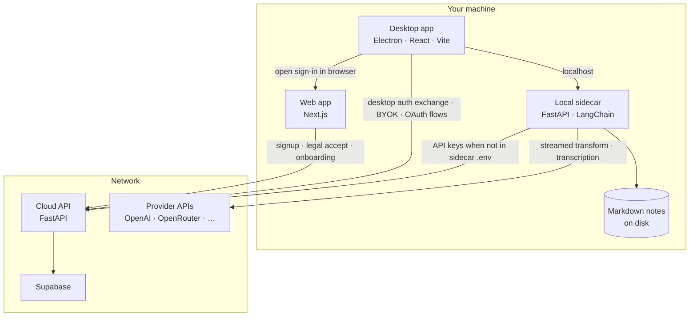

# Notebook AI

Desktop-first AI note taker with a local-first Electron UX, a Next.js web app, and FastAPI/LangChain backends.

## Architecture

Notebook AI is a monorepo:
- `apps/desktop`: Electron + React + Vite desktop recorder/editor
- `apps/web`: Next.js landing, signup, legal acceptance, onboarding, and web settings
- `services/local-sidecar`: local FastAPI note/transcript API
- `services/cloud-api`: hosted FastAPI auth/provider/settings API
- `packages/contracts`: shared TypeScript API contracts
- `packages/theme`: shared design tokens (light/dark)
- `packages/ui`: shared React primitives

## Why a local sidecar?

A **sidecar** here is a small **local HTTP service** you run next to the desktop app (not a second cloud). It exists so normal work stays **local-first and low-latency**:

- **Notes:** Create, list, and save markdown through the sidecar so content stays on your filesystem and the UI does not depend on a remote service for every edit.
- **AI and transcription:** Streaming transforms and audio round-trips go to the sidecar on `localhost`, which talks to provider APIs using keys from your env or from the cloud vault—so you get responsive streaming without routing note bodies or every model call through hosted infrastructure.

The **cloud API** is a separate companion: Supabase auth validation, session refresh/logout, legal acceptance, provider OAuth/BYOK, storage preferences, desktop auth handoff, and Drive integration metadata. It does **not** store your note markdown or sit in the path for debounced note persistence.

## UX Highlights

- Fast local-first note editing with debounced persistence
- Streaming AI action panel (`summarize`, `rewrite`, `extract_action_items`)
- Unified web + desktop visual system with shared tokens/components
- Dark and light themes with persisted preference

## Quick Start

1. Install workspace dependencies:
   - `npm install`
2. Create Python envs for each service and install dependencies:
   - `cd services/local-sidecar && python3.11 -m venv .venv && source .venv/bin/activate && pip install -e .'[dev]'`
   - `cd services/cloud-api && python3.11 -m venv .venv && source .venv/bin/activate && pip install -e '.[dev]'`
3. Run services (requires a `.venv` in each service from step 2 so npm uses **Python ≥3.11**, not the system `python3`—e.g. Xcode’s 3.9 will fail on type hints):
   - From repo root: `npm run dev:sidecar` (8787) and `npm run dev:cloud` (8790) in separate terminals, or `npm run dev:services` for both with reload. Scripts call `services/*/ .venv/bin/python` (macOS/Linux).
   - **Windows:** from each service directory run `.venv\Scripts\python.exe -m uvicorn app.main:app --reload --port 8787` (or `8790` for cloud-api).
   - Or activate a venv and run `uvicorn app.main:app --reload --port 8787` / `--port 8790` (omit `--reload` during long live capture if you prefer).
4. Run web app:
   - `npm run dev:web`
5. Run desktop app:
   - `npm run dev:desktop`

## Setup Guides

- [Supabase, Google Sign-In, and Google Drive Setup](./docs/supabase-google-setup.md)

## Environment

See `.env.example` in:
- `services/local-sidecar`
- `services/cloud-api`
- `apps/desktop`
- `apps/web`

## API Surface

- Local sidecar:
  - `POST /notes`
  - `GET /notes`
  - `PUT /notes/{id}`
  - `PATCH /notes/{id}/move`
  - `DELETE /notes/{id}`
  - `GET /folders`
  - `POST /folders`
  - `PATCH /folders/{id}`
  - `DELETE /folders/{id}`
  - `GET /storage/local-root`
  - `PUT /storage/local-root`
  - `GET /storage/preference`
  - `PUT /storage/preference`
  - `GET /sync/status`
  - `POST /sync/run`
  - `POST /ai/transform/stream` (SSE)
  - `GET /providers/status`
  - `POST /providers/status/cache`
- Cloud API:
  - `POST /auth/session/refresh`
  - `POST /auth/logout`
  - `GET /legal/current`
  - `POST /legal/accept`
  - `GET /legal/accept`
  - `GET /settings/storage`
  - `PUT /settings/storage`
  - `POST /providers/openai/oauth/start`
  - `GET /providers/openai/oauth/callback`
  - `POST /integrations/google-drive/oauth/start`
  - `GET /integrations/google-drive/oauth/callback`
  - `GET /integrations/google-drive/status`
  - `POST /integrations/google-drive/access-token`
  - `POST /providers/byok`
  - `GET /providers/status`
  - `GET /providers/credential`
  - `DELETE /providers/{provider}`
